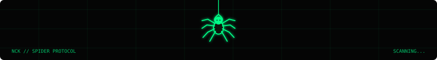

<div align="center">



<a href="https://github.com/NipunChamodya?tab=repositories">
  
</a>
<a href="https://github.com/NipunChamodya">
  
</a>

<br>


</div>

---

## `01 / ABOUT`

I'm a final-year Software Engineering student from Sri Lanka interested in building practical software and understanding how systems behave beneath the surface.

- **Engineering** — software design, object-oriented programming, testing, and maintainable code.
- **Security** — application security, networking, and ethical security research.
- **Systems** — local services, data handling, and how components communicate.
- **Product craft** — native macOS and Android apps with thoughtful user experiences.

## `02 / PROJECT EXPLORER`

Use the category links to jump to a project group. Open each panel to see its summary. GitHub READMEs cannot run custom JavaScript, so these are genuine expandable panels rather than JavaScript-powered live filters.

<p align="center">
  <a href="#mobile--android">[ MOBILE / ANDROID ]</a> ·
  <a href="#macos--desktop">[ MACOS / DESKTOP ]</a> ·
  <a href="#web--developer-tools">[ WEB / DEVELOPER TOOLS ]</a>
</p>

### Mobile / Android

<details>
<summary><strong>01 — NetShield</strong> · Android network privacy</summary>

An Android project exploring local DNS-based blocking and network privacy controls.

**Technologies:** Kotlin · Jetpack Compose · Coroutines/Flow · Hilt · Room · Android `VpnService`

[Browse public repositories](https://github.com/NipunChamodya?tab=repositories)

</details>

<details>
<summary><strong>02 — Tailor Manager</strong> · Tailoring and rental workflows</summary>

A management-app concept for tailoring measurements, rental bookings, customer records, payment tracking, and reminders.

**Focus:** workflow design · local data management · customer-facing records

[Browse public repositories](https://github.com/NipunChamodya?tab=repositories)

</details>

### macOS / Desktop

<details>
<summary><strong>03 — SinhalaPlayer</strong> · Native macOS media player concept</summary>

Exploring a Mac-first media player experience with Sinhala subtitle support and a polished viewing workflow.

**Exploration:** SwiftUI · macOS · media playback · subtitle workflows

[Browse public repositories](https://github.com/NipunChamodya?tab=repositories)

</details>

### Web / Developer Tools

<details>
<summary><strong>04 — SpiderDeck</strong> · Controlled web crawling</summary>

A Python project exploring controlled crawling and security-conscious URL and file-path validation.

**Focus:** Python · validation · testing · safer input handling

[Browse public repositories](https://github.com/NipunChamodya?tab=repositories)

</details>

> Project summaries describe the projects and areas of work discussed; check each repository for current implementation status. Replace any entry that does not yet have a public repository with a link to the actual project when available.

## `03 / TOOLKIT`

<p align="center">
  
</p>

**Areas of interest:** Software Engineering · Application Security · Networking · Reverse Engineering · Native macOS Development

## `04 / GITHUB SIGNAL`

<div align="center">

<a href="https://github.com/NipunChamodya">
  
</a>
<a href="https://github.com/NipunChamodya">
  
</a>

<br>


</div>

*Stats are generated by third-party services and may be cached, unavailable, or calculated differently from GitHub's own profile activity.*

## `05 / PRINCIPLES`

```text
01  Understand the problem.
02  Question assumptions.
03  Test the boundaries.
04  Read the source.
05  Build, measure, improve.
```

<div align="center">

**BUILD · INVESTIGATE · UNDERSTAND · IMPROVE**

<sub>Learning in public. Building with purpose.</sub>

</div>
